# Assignment #6: jQuery (Selectors, Effects, Animations)
**Name:** Suleimen Khanzere
**Group:** IT-2504

## Task 0. Setup
- Included jQuery from a CDN.
- Used `$(document).ready(function() { ... })`.
- Printed `jQuery is ready!` in the browser console.

## Task 1. Selectors & CSS
- Displayed my name, headline, introduction, and portfolio title.
- Used tag, ID, and class selectors.
- Updated the headline using `.text()`.
- Changed styling using `.css()`.
- Added buttons to switch between light and dark themes.

### Screenshot
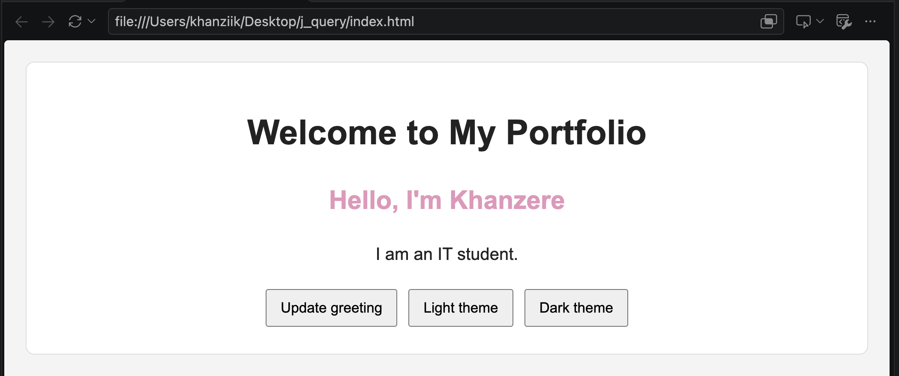
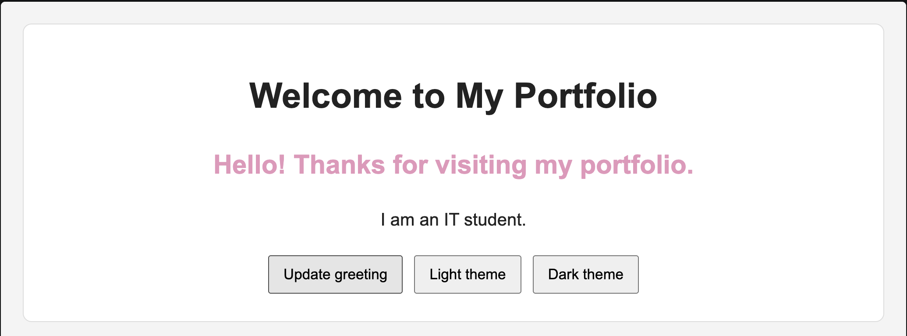
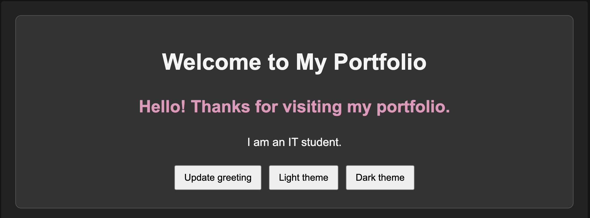

## Task 2. Visibility Methods

- Created an About Me section.
- Added a biography, status message, and fun facts.
- Used `.hide()`, `.show()`, and `.toggle()` to control visibility.

### Screenshot
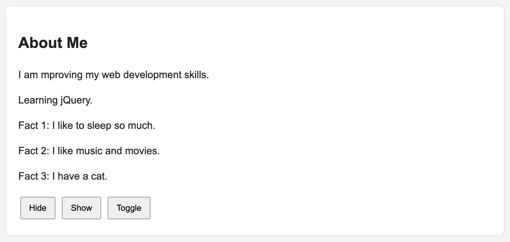
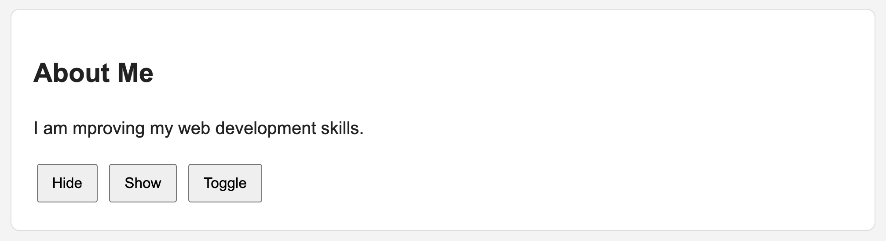

## Task 3. Fade Methods

- Added two gallery images.
- Used `.fadeIn()`, `.fadeOut()`, and `.fadeToggle()` to control image visibility.

### Screenshot
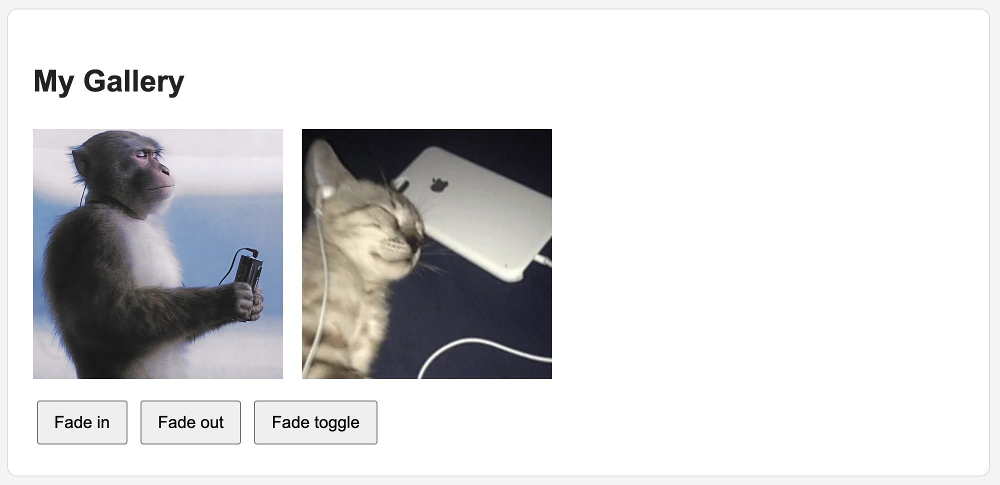\
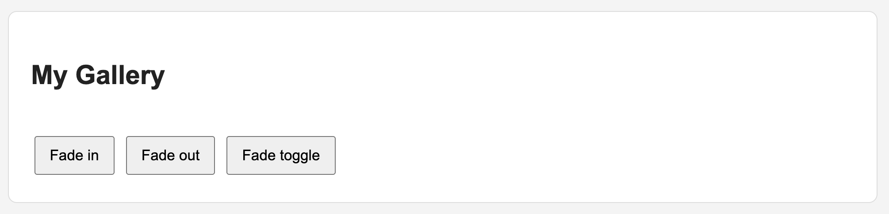

## Task 4. Slide Methods

- Created three clickable headings.
- Added information panels below the headings.
- Used `.slideUp()`, `.slideDown()`, and `.slideToggle()`.

### Screenshot
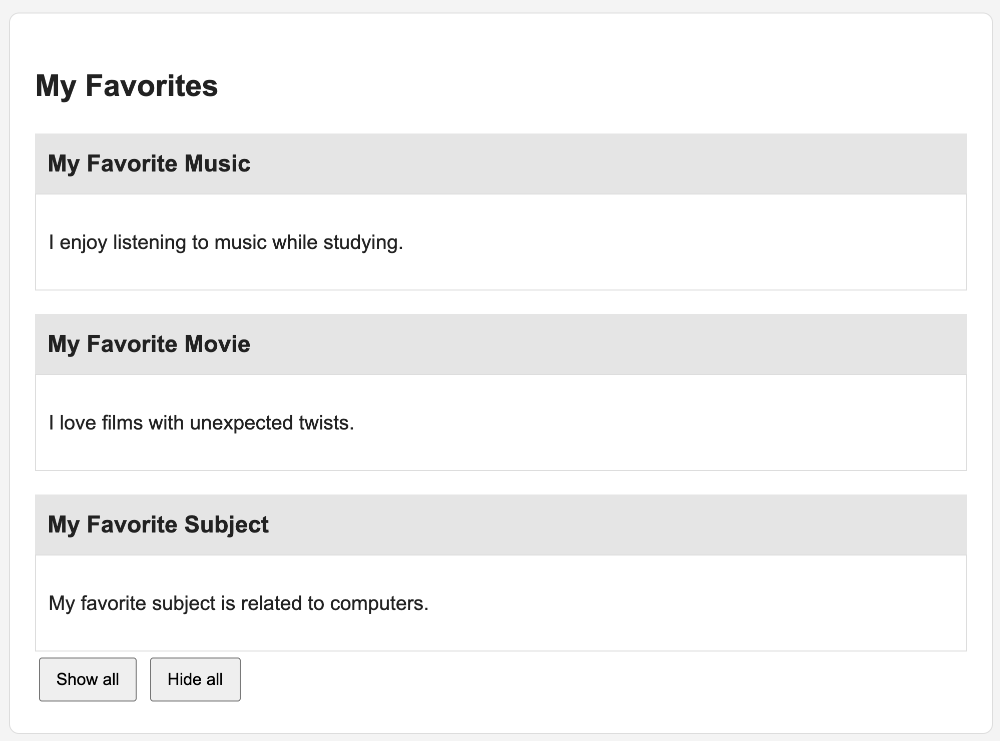
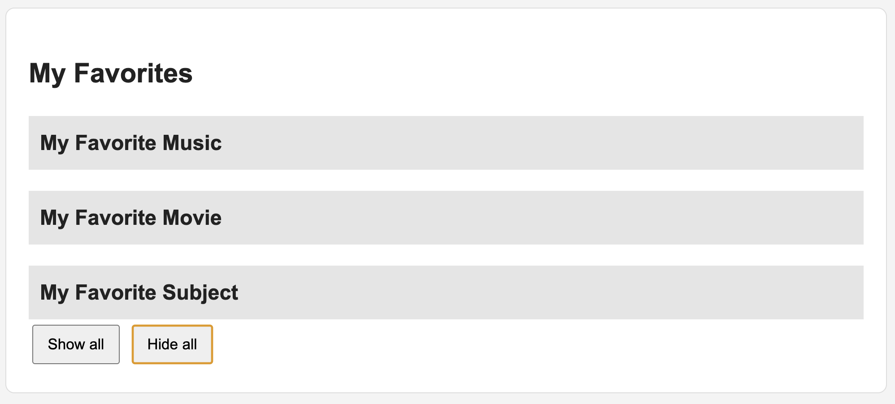

## Task 5. Add & Remove Elements

- Created an initial list with four technical skills.
- Added an input field and three buttons.
- Used `.append()`, `.prepend()`, and `.remove()`.
- Prevented empty skills from being added.

### Screenshot
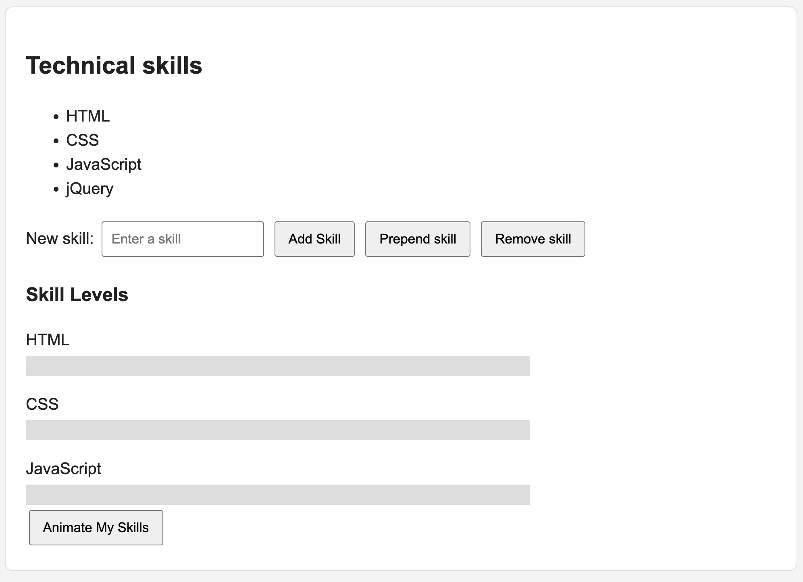
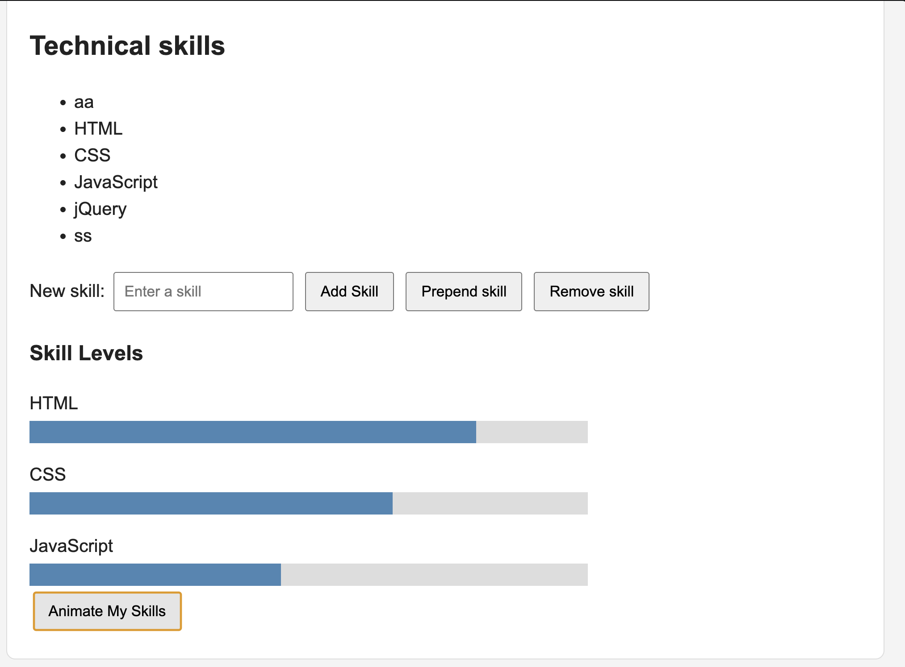

## Task 6. Modifying Attributes

- Added a social media link.
- Used `.attr()` to change the link destination between GitHub and LinkedIn.

### Screenshot
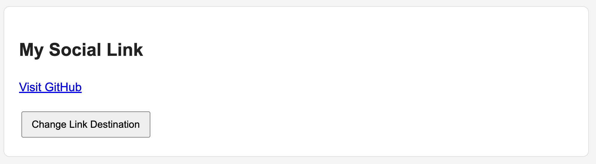
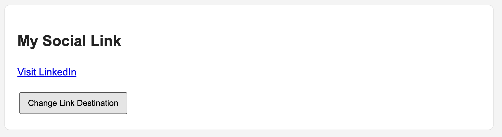

## Task 7. Form Interaction

- Created Name and Email input fields.
- Used `.val()` to read the input values.
- Used `.text()` to display the values while typing.

### Screenshot
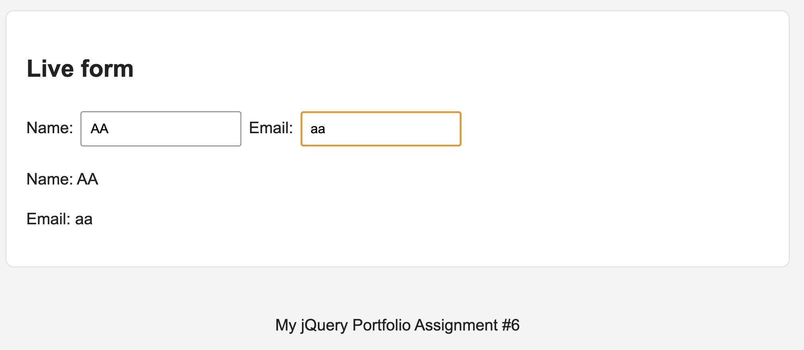

## Task 8. Basic Animation

- Created three skill bars that initially have zero width.
- Used `.animate()` to display different skill levels.
- Added a button to animate the bars back to zero width.

## Summary

In this assignment, I created a portfolio page to practise jQuery selectors, CSS changes, event handling, visibility effects, DOM manipulation, attribute changes, form interaction, and animations.

I tested the required interactions in the browser and captured screenshots of the tasks.